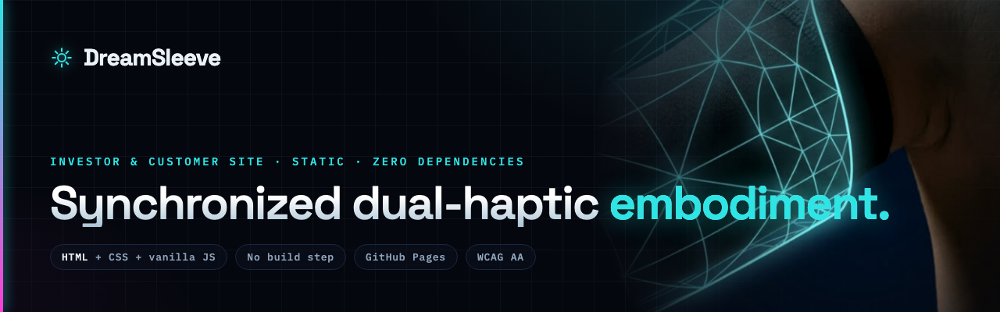
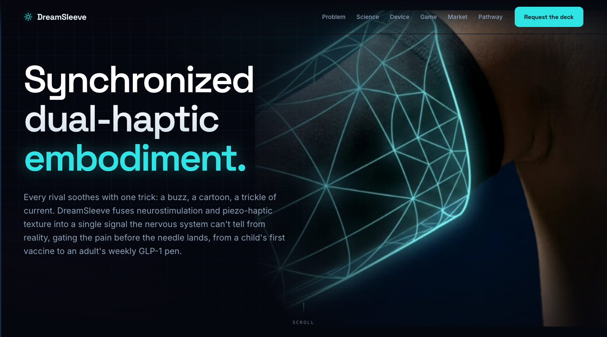
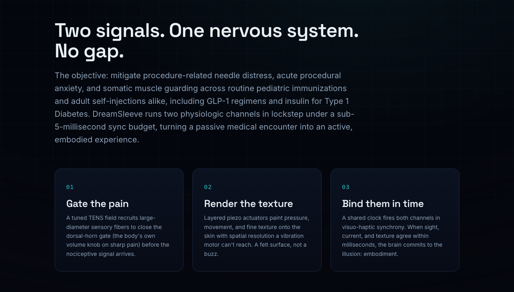
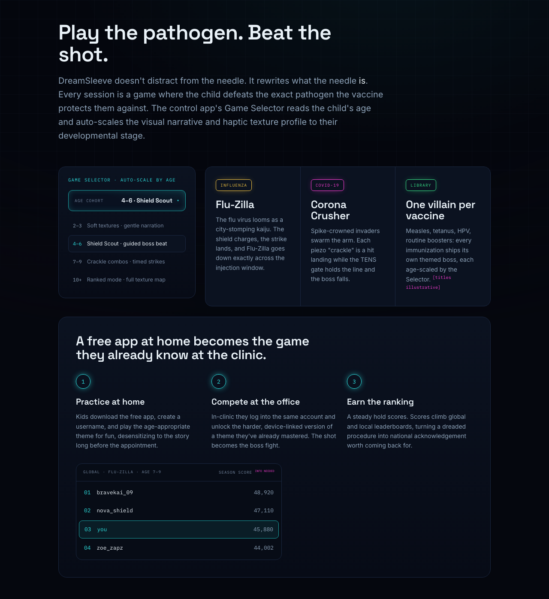
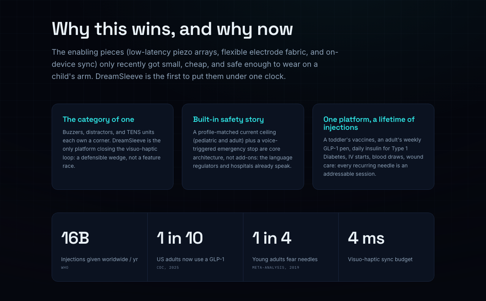

<div align="center">



# DreamSleeve &middot; Investor &amp; Customer Site

**Synchronized dual-haptic embodiment.** A single-page, dependency-free static site for DreamSleeve, an arm-worn neurostimulation + piezo-haptic sleeve that gates needle distress across pediatric immunizations and adult self-injection.

[](https://dreamsuit.github.io/DREAMSUIT-WEBSITE-MAIN/)
[](#-software-architecture)
[](#-setup--local-development)
[-2FE4E4?style=flat-square&labelColor=0B1220)](#-software-architecture)
[](#-accessibility)
[](#-deployment)

**[→ View the live site](https://dreamsuit.github.io/DREAMSUIT-WEBSITE-MAIN/)**

</div>

---

## Contents

- [Overview](#-overview)
- [Site walkthrough](#-site-walkthrough)
- [Software architecture](#-software-architecture)
- [Design system](#-design-system)
- [Setup &amp; local development](#-setup--local-development)
- [Deployment](#-deployment)
- [Configuration (before launch)](#-configuration-before-launch)
- [Accessibility](#-accessibility)
- [Performance](#-performance)
- [Regenerating the generated assets](#-regenerating-the-generated-assets)
- [Disclaimer](#-disclaimer)

---

## 🔭 Overview

DreamSleeve is a dual-action wearable sleeve: **TENS** neurostimulation engages the spinal Gate Control Theory of pain while **high-frequency piezoelectric** actuators render tactile texture, in synchrony, turning a passive injection into an active, embodied experience. This site is the **investor- and customer-facing** story for the product.

- **One page, no framework, no build step.** Hand-authored HTML, one CSS design system, and ~190 lines of vanilla JavaScript.
- **Cinematic scroll** via **GSAP + ScrollTrigger** — vendored and self-hosted in `assets/vendor/` (no CDN, no npm), loaded `defer`. It's a progressive enhancement: if the libs don't load, or the visitor prefers reduced motion, the site degrades to `IntersectionObserver` reveals. The only other third party is Google Fonts (CSS); optional cookie-less GoatCounter analytics load only if a site code is configured.
- **Deploys anywhere static.** Every asset path is relative, so it runs correctly from a domain root *or* a GitHub Pages project sub-path.
- **Accessible and fast.** WCAG 2.1 AA colour contrast, a keyboard-accessible mobile nav, `prefers-reduced-motion` support, lazy-loaded imagery.

The neuro-tech "HUD" aesthetic (deep-space navy, cyan signal, magenta charge, pass-green states, diegetic monospace readouts) runs through every section.

---

## 🖼 Site walkthrough

### Hero
The opening statement, over a photographic arm wearing the sleeve with a glowing cyan wireframe overlay (right-anchored, CSS-masked into the void). Headline, dual-audience lede, and a CTA into the science.



### The science
Three pillars: **gate the pain** (Aβ-fibre recruitment + deltoid muscle-guarding relief), **render the texture** (layered piezo), and **bind them in time** (sub-5 ms visuo-haptic synchrony).



### The game: play the pathogen
A diegetic **Game Selector** that auto-scales the narrative and haptic texture by developmental age cohort, pathogen game tiles (Flu-Zilla, Corona Crusher), and a practice → compete → leaderboard flywheel.



### The market
Real, sourced, dual-audience figures with inline attribution (WHO / CDC 2025 / 2019 meta-analysis) and the competitive moat.



---

## 🏗 Software architecture

### Stack

| Layer | Choice | Why |
|---|---|---|
| Markup | Hand-authored **HTML5** (`index.html`, ~360 lines) | One document, full SEO/OG/Twitter/JSON-LD, semantic landmarks |
| Styles | One **CSS** file (`styles/main.css`, ~350 lines) | Custom-property design system, component classes, responsive, reduced-motion |
| Behaviour | **Vanilla JS** (`scripts/main.js`, ~190 lines) | No framework; `defer`-loaded; rAF-throttled; passive listeners |
| Motion | **GSAP 3.12 + ScrollTrigger** (`assets/vendor/`, vendored) | Cinematic scroll: hero scrub parallax, parallax layers, section reveals, section snapping + keyboard nav. Degrades to IO reveals |
| Fonts | Google Fonts (Space Grotesk, Inter, IBM Plex Mono) | `display=swap`, preconnected |
| Analytics | GoatCounter (optional) | Cookie-less, privacy-friendly; loads only when configured |
| Hosting | GitHub Pages (static) | `.nojekyll`, relative paths |

No bundler, transpiler, package manager, or CI is required. **What is in the repo is what ships.**

### File structure

```
.
├── index.html              # the whole page: content + SEO/OG/Twitter + JSON-LD + import-free
├── styles/
│   └── main.css            # design tokens, components, responsive, reduced-motion
├── scripts/
│   └── main.js             # loading splash · cinematic scroll (GSAP) · reveals · section nav (snap + keys) · mobile nav · scroll-spy
├── assets/
│   ├── vendor/             # gsap.min.js + ScrollTrigger.min.js (vendored, no CDN)
│   ├── hero-arm.jpg        # hero photo (40 KB)
│   ├── og-image.png        # 1200×630 social share card
│   ├── favicon.svg · favicon-32.png · apple-touch-icon.png
├── docs/
│   ├── banner-template.html    # source for the README banner
│   └── screenshots/*.png       # README imagery
├── site.webmanifest        # PWA manifest (subpath-relative start_url/scope)
├── sitemap.xml · robots.txt · llms.txt · .nojekyll · CNAME.disabled
├── README.md · PLAN.md · CHANGELOG.md
```

### JavaScript modules (`scripts/main.js`)

All logic lives in a single IIFE, is `prefers-reduced-motion`-aware, and runs with one rAF-throttled scroll loop:

| Module | Responsibility |
|---|---|
| **Loading splash** | Brand splash on load (radiant-node mark + wordmark + progress bar + HUD label); GSAP-timeline dismissal after a ~1.5 s minimum, scroll-locked, tap-to-skip, reduced-motion-aware, CSS fade fallback |
| **Cinematic scroll (GSAP)** | Hero scrub parallax (copy drifts up + dissolves while the arm photo pushes in), parallax layers (grid + headlines), and staggered section reveals that replay on re-entry. Gated behind `prefers-reduced-motion`; absent if GSAP fails to load |
| **Section navigation** | Gentle proximity snap after the wheel/trackpad settles near a section start, plus **arrow / Page / Home / End** keyboard navigation (works with or without GSAP). Native smooth scroll, so it isn't blocked by any trigger |
| **Scroll reveals (fallback)** | When GSAP isn't driving: `IntersectionObserver` adds `.is-in` to `[data-reveal]` elements; reduced-motion shows them immediately |
| **Count-up stats** | Animates `[data-count]` numbers when they enter the viewport (eased, reduced-motion sets the final value) |
| **Progress rail** | The left-edge rail "charges" from cyan to magenta as you scroll |
| **Mobile nav** | Hamburger toggle (`aria-expanded`/`aria-controls`); opens a dropdown below 920px, closes on Escape / link tap / resize |
| **Active-nav scroll-spy** | `IntersectionObserver` highlights the in-view section's nav link (`aria-current`) |

### CSS architecture (`styles/main.css`)

- **Design tokens** as `:root` custom properties (colours, type scale, spacing, easing): see [Design system](#-design-system).
- **Component-scoped classes** (BEM-ish: `.hero__inner`, `.stat__num`, `.phase-panel__time`). The monospace font is used only for genuine instrument values, never decorative labels.
- **Two responsive breakpoints** (920 px, 560 px); grids collapse to one column.
- **`prefers-reduced-motion`** block neutralises every animation/transition.
- A fixed engineering-grid canvas + scroll rail provide the ambient HUD backdrop.

---

## 🎨 Design system

### Colour

| Token | Hex | Role | |
|---|---|---|---|
| `--void` | `#05070E` | Page canvas, deep-space navy |  |
| `--panel` | `#0B1220` | Raised panel surfaces |  |
| `--signal` | `#2FE4E4` | **Cyan** — primary accent, live data, links |  |
| `--pulse` | `#FF3DD8` | **Magenta** — rare "charge" emphasis |  |
| `--pass` | `#38E88A` | **Green** — validated / engaged states |  |
| `--amber` | `#F5C542` | Prep-stage accent |  |
| `--text` | `#EAF2F8` | Primary text |  |
| `--muted` | `#8DA2B8` | Secondary text |  |
| `--faint` | `#7587a0` | Small labels (AA-tuned) |  |

### Typography

- **Space Grotesk** — display/headlines (geometric technical grotesk; tight tracking).
- **Inter** — body copy (≤70ch line length, sentence case).
- **IBM Plex Mono** — diegetic instrument labels only (status words, timecodes, counters).

### Motion &amp; principles

1. **Diegetic instrumentation** — the UI carries a HUD character: the progress rail charges, counters tick up, status pills read like live readouts.
2. **Cinematic, but disciplined** — GSAP drives a scrub parallax hero and parallax layers, reveals cascade as sections enter, and sections snap gently into place; all of it is gated behind `prefers-reduced-motion` and degrades to static reveals.
3. **Spend boldness once** — magenta is the rare charge colour; cyan is the workhorse.

---

## 🛠 Setup &amp; local development

No build, no install. Clone and serve the folder over HTTP (needed because the page uses `fetch` and a manifest; `file://` will not do):

```bash
git clone https://github.com/DreamSuit/DREAMSUIT-WEBSITE-MAIN.git
cd DREAMSUIT-WEBSITE-MAIN

# any static server works, e.g.:
python3 -m http.server 8000
# then open http://localhost:8000/
```

Edit `index.html` / `styles/main.css` / `scripts/main.js` and refresh. That is the whole loop.

---

## 🚀 Deployment

Hosted on **GitHub Pages** as a project page at **`https://dreamsuit.github.io/DREAMSUIT-WEBSITE-MAIN/`** (a sub-path, not a root domain).

1. Push to the default branch (`main`, root, not `/docs`).
2. Repo **Settings → Pages → Build and deployment → Source: Deploy from a branch → `main` / `(root)`**. `.nojekyll` is included so Pages serves files as-is.
3. Because it publishes at a sub-path, **every asset path in the site is relative** (CSS, JS, images, fonts, manifest), so everything loads correctly there. The only absolute URLs (canonical, OG/Twitter image, JSON-LD, `sitemap.xml`, `robots.txt`) already point at the project URL.

**Custom domain (optional):** add it under Settings → Pages, commit a `CNAME` file with the domain, and change the absolute-URL host from `dreamsuit.github.io/DREAMSUIT-WEBSITE-MAIN` to your domain in `index.html`, `sitemap.xml`, and `robots.txt`. DNS: `A` records for the apex → GitHub Pages IPs (`185.199.108–111.153`), or a `CNAME` for `www` → `dreamsuit.github.io`. Enable **Enforce HTTPS** once the cert provisions.

---

## ⚙ Configuration (before launch)

Search the repo and fill these in:

- **Analytics (GoatCounter):** privacy-friendly, no cookies. Register a free site at [goatcounter.com](https://www.goatcounter.com/), then replace `YOUR_CODE` in the analytics snippet near the bottom of `index.html` with your subdomain. Until configured, nothing is loaded or sent.
- **`INFO NEEDED` field** (magenta tag in the UI; grep `index.html` for `INFO NEEDED`): the leaderboard season score in the Game section. The Market stats are already real sourced figures (see the `<i>` source tags).
- **Host URL:** only change if you move to a custom domain (see Deployment).

> The `[titles illustrative]` tag on the game titles is a clarifier, not missing data.

---

## ♿ Accessibility

Targets **WCAG 2.1 AA**. Verified:

- **Contrast:** all text colours pass AA on their backgrounds (the small-label `--faint` was tuned to `#7587a0` for this).
- **Semantics:** one `<h1>`, correct heading order, `<header>/<nav>/<main>/<footer>` landmarks, a working skip link to `#top`.
- **Mobile nav:** hamburger toggle with `aria-expanded`/`aria-controls`, Escape to close, roving focus, visible focus ring.
- **Keyboard navigation:** Arrow / Page / Home / End keys move between sections (ignored inside form fields and when modifier keys are held).
- **Motion:** `prefers-reduced-motion` neutralises every animation; the WebGL-free design has no seizure/vestibular risk surface.
- **Images:** decorative images use empty `alt` + `aria-hidden`.
- Zoom is allowed (no `maximum-scale`), `lang="en"` is set, link text is descriptive.

---

## ⚡ Performance

- **No framework, no build step.** `scripts/main.js` is ~8 KB of vanilla JS, `defer`-loaded, with a single rAF-throttled scroll loop and passive listeners. GSAP + ScrollTrigger add ~113 KB (minified, ~45 KB gzipped), also `defer`-loaded so they never block first paint; the cinematic layer is a progressive enhancement.
- **Imagery is light:** the hero photo is 40 KB and lazy-decoded; no other raster assets ship on the page.
- **No layout shift:** every content image has explicit `width`/`height`; below-the-fold images are `loading="lazy"`.
- Fonts preconnect and use `display=swap`.

---

## 🔁 Regenerating the generated assets

The branded assets were rendered from HTML templates with headless Chrome:

- **README banner:** `docs/banner-template.html` → `docs/screenshots/banner.png` (1280×400).
- **Social share image:** an HTML template → `assets/og-image.png` (1200×630).
- **Section screenshots:** rendered from the live sections (one per `docs/screenshots/*.png`).

Render any template with: `chrome --headless --screenshot=out.png --window-size=W,H <url>`.

---

## ⚠ Disclaimer

DreamSleeve is positioned as a **General Wellness** product under FDA policy for comfort, relaxation, and sensory soothing. It is **not** a cleared or approved medical device and makes no diagnostic or treatment claims.
